[English](./README.en.md) · [Website](https://agentgate.lei6393.com) · [GitHub](https://github.com/SuperMarioYL/agentgate)

<picture>
  <source media="(max-width: 600px) and (prefers-color-scheme: dark)" srcset="./assets/presentation/hero-mobile-dark.svg">
  <source media="(max-width: 600px)" srcset="./assets/presentation/hero-mobile-light.svg">
  <source media="(prefers-color-scheme: dark)" srcset="./assets/presentation/hero-dark.svg">
  
</picture>

# AgentGate

**在 Agent 动作执行前检查授权。**

AgentGate 用命令 shim 与 HTTP(S) 代理包裹编码会话，按有序 YAML 策略裁决动作，并记录 JSONL 审计日志。

## 为什么需要它

依赖安装与网络出口需要不同规则。策略可以在 npm install 前询问、放行包仓库并拒绝未声明主机；会话开始前可用 check 预览这些裁决。

- **预览规则** — check 无需执行动作即可解释裁决。
- **区分动作类型** — 命令与网络出口使用独立匹配规则。
- **保留审计轨迹** — 运行时裁决可按动作、结果与时间过滤。

## 架构

<picture>
  <source media="(max-width: 600px) and (prefers-color-scheme: dark)" srcset="./assets/presentation/architecture-mobile-dark.svg">
  <source media="(max-width: 600px)" srcset="./assets/presentation/architecture-mobile-light.svg">
  <source media="(prefers-color-scheme: dark)" srcset="./assets/presentation/architecture-dark.svg">
  
</picture>

已配置的 PATH shim 将截获命令交给 Unix socket broker；经过代理的流量进入同一 Gate Engine，按首条匹配规则决定，必要时询问操作者。审计模块记录运行时裁决；check 只对假设动作执行策略解析。

| 组件 | 职责 |
| --- | --- |
| `Command shims` | internal/wrap/spawn.go |
| `Socket broker + proxy` | internal/gate |
| `Ordered policy` | internal/policy |
| `Prompt + audit` | internal/prompt; internal/audit |

## 安装与快速上手

使用仓库清单声明的运行时版本。以下源码安装步骤可复现随仓示例。

```bash
git clone https://github.com/SuperMarioYL/agentgate.git
cd agentgate
go build ./cmd/agentgate
```

Python 脚本对完整供应链策略检查四个动作；Python 3 只用于示例驱动。

```bash
python3 examples/presentation_demo.py
```

## 实际运行示例

<picture>
  <source media="(max-width: 600px) and (prefers-color-scheme: dark)" srcset="./assets/presentation/process-mobile-dark.svg">
  <source media="(max-width: 600px)" srcset="./assets/presentation/process-mobile-light.svg">
  <source media="(prefers-color-scheme: dark)" srcset="./assets/presentation/process-dark.svg">
  
</picture>

curl is denied; npm install asks; the registry is allowed; its look-alike hostname is denied.

```text
action  : exec
target  : curl http://evil.example
intent  : agent wants to fetch a URL via curl: http://evil.example
decision: deny (matched a rule)
action  : exec
target  : npm install left-pad
intent  : agent wants to install npm package: left-pad
decision: ask (matched a rule)
action  : net_egress
target  : registry.npmjs.org:443
intent  : agent wants to reach registry.npmjs.org:443
decision: allow (matched a rule)
action  : net_egress
target  : registry.npmjs.org.evil.example:443
intent  : agent wants to reach registry.npmjs.org.evil.example:443
decision: deny (matched a rule)
```

完整命令与输出保存在 [docs/demo-results.json](./docs/demo-results.json). 输入和复现代码均随仓提供。


保留已有录制供参考；上方文字示例给出当前可复现的操作。

## 用法

安装后在仓库根目录运行以下命令；处理自己的数据时替换相应路径。

```bash
go run ./cmd/agentgate init
go run ./cmd/agentgate policy --policy examples/policies/supply-chain.yaml
go run ./cmd/agentgate policy --policy examples/policies/supply-chain.yaml --explain --action exec "npm install chalk"
go run ./cmd/agentgate audit --decision deny --json
```

## 配置

--policy 或 AGENTGATE_POLICY 指定策略，--audit 或 AGENTGATE_AUDIT 指定日志。--enforce 在无终端时把 ask 判为 deny；--no-net 关闭网络代理门控。规则使用 filepath 风格 glob，不是正则，也不支持 | 或运算。裸主机名按主机边界匹配；.github.com 表示子域，不含顶级域。用 policy rm 撤销已保存规则前应检查规则顺序：--policy 同时适用于 policy 及其 rm 子命令，可在列出的同一策略文件中撤销规则。action 不是 exec、fs_write、net_egress 的规则会在解析策略时被拒绝，拼错的规则不会静默失效。每条审计记录都会写明裁决来源：rule、default、operator、no-operator、always 或 enforce。

## 集成与职责分工

<picture>
  <source media="(max-width: 600px) and (prefers-color-scheme: dark)" srcset="./assets/presentation/integrations-mobile-dark.svg">
  <source media="(max-width: 600px)" srcset="./assets/presentation/integrations-mobile-light.svg">
  <source media="(prefers-color-scheme: dark)" srcset="./assets/presentation/integrations-dark.svg">
  
</picture>

根据工作流选择输入与输出路径。本文本地示例验证其中明确说明的子流程。

| 路径 | 已实现职责 |
| --- | --- |
| YAML policy | First match wins; allow / deny / ask |
| Configured executables | PATH shim interception |
| HTTP(S) proxy | Host-based egress decisions |
| JSONL | Runtime audit and filters |
| check / policy | Dry-run explanation and rule management |

## 限制与后续方向

- 这不是完整主机沙箱。自定义二进制、直接 shell spawn 与绕过代理的流量不在这些截获路径内。
- fs_write 规则仅支持 check，尚未实现运行时文件写入截获。
- 示例仅裁决假设动作，不验证进程隔离或实时网络拦截。

运行时文件写入插桩、更多框架适配与团队共享策略仍是后续方向；随仓供应链 cookbook 展示当前匹配器的用法。

## 许可与贡献

许可见 [LICENSE](./LICENSE). 反馈问题时请提供最小输入、执行命令和实际输出。
